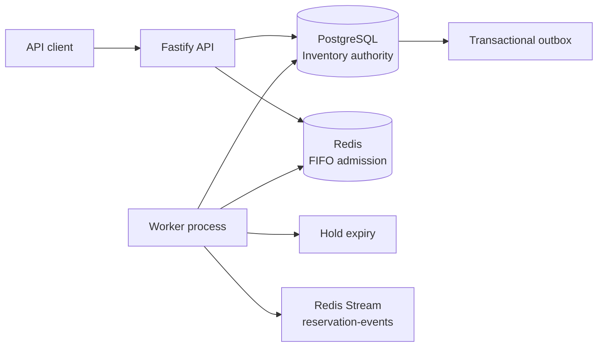

# Event Ticket Reservation System

Backend API for assigned-seat ticket reservations under high demand. The service focuses on the hard parts of a ticket drop: one owner per seat, all-or-nothing multi-seat holds, idempotent retries, safe expiry, and a FIFO waiting room.

This is a portfolio project, not a payment processor. Confirmation means the booking was accepted by this service. There is no customer-facing frontend or account system; reservation and queue access use opaque bearer capabilities.

## Guarantees and boundaries

- PostgreSQL is the source of truth for events, inventory, holds, and confirmed bookings. Redis never grants seat ownership.
- A request locks the requested inventory rows in sorted UUID order and changes every requested seat in one PostgreSQL transaction. If one seat is unavailable, the whole request fails.
- A hold defaults to five minutes. The API checks PostgreSQL time while confirming and when a new hold encounters a stale reservation; a worker also releases due holds in bounded batches.
- Confirmation and expiry serialize on the reservation row. A confirmed seat cannot be released by a later expiry batch.
- The `Idempotency-Key` is scoped to an event and retained for 24 hours. Same key and same seats replay the original reservation and capability. Same key with different seats returns `409 IDEMPOTENCY_KEY_REUSED`.
- Reservation capabilities are HMAC-derived from the reservation ID and a configured key version. PostgreSQL stores a SHA-256 hash, never the bearer value. Keep old capability keys configured while reservations minted with them can still be used.
- A waiting-room admission allows a short period to attempt reservation; it does not allocate inventory. Queue-enabled events fail closed if Redis cannot validate admission. Existing holds can still be read and confirmed from PostgreSQL.
- State changes and notification records commit together through a transactional outbox. Redis Stream delivery is at least once; consumers must deduplicate using the `eventId` field.

## Architecture



The API and worker are separate processes from one TypeScript codebase and one container image. Modules are grouped by events, reservations, waiting room, outbox, and shared platform concerns. HTTP routes validate input and call application services; critical concurrency rules are explicit SQL.

## Requirements

- Node.js 24 or later
- Docker Engine with Compose
- npm

## Run locally

```bash
cp .env.example .env
docker compose up -d postgres redis
npm ci
npm run db:migrate
npm run db:seed
npm run dev
```

In another terminal, run the worker:

```bash
npm run dev:worker
```

Or start the complete containerized stack:

```bash
docker compose up --build
```

The Compose stack runs migrations before the API and worker. Local demo credentials are intentionally non-production. Set a unique `CAPABILITY_KEYS` secret of at least 32 characters before deploying anywhere shared.

## API examples

The seed command creates event `11111111-1111-4111-8111-111111111111` with 100 assigned seats and an enabled waiting room. Interactive OpenAPI documentation is available at `http://localhost:3000/docs`.

Join and poll the waiting room:

```bash
curl -sS -X POST http://localhost:3000/v1/events/11111111-1111-4111-8111-111111111111/waiting-room
curl -sS -H 'Authorization: Bearer <entry-capability>' http://localhost:3000/v1/waiting-room/<entry-id>
```

Create a hold using an admitted token:

```bash
curl -i -X POST http://localhost:3000/v1/events/11111111-1111-4111-8111-111111111111/reservations \
  -H 'Content-Type: application/json' \
  -H 'Idempotency-Key: checkout-8f31e' \
  -H 'X-Admission-Token: <admission-token>' \
  -d '{"seatIds":["22222222-2222-4222-8222-000000000001"]}'
```

The worker admits queued entries according to `waiting_room_events.admission_capacity`; the returned reservation contains a capability used to inspect and confirm the hold:

```bash
curl -sS -H 'Authorization: Bearer <reservation-capability>' \
  http://localhost:3000/v1/reservations/<reservation-id>

curl -i -X POST -H 'Authorization: Bearer <reservation-capability>' \
  http://localhost:3000/v1/reservations/<reservation-id>/confirm
```

Inventory discovery endpoints are `GET /v1/events` and `GET /v1/events/:eventId/seats`. Liveness and readiness are exposed at `/health/live` and `/health/ready`; Prometheus metrics are at `/metrics`.

## Checks and contention exercise

```bash
npm run format:check
npm run lint
npm run typecheck
npm run test:unit
npm run test:integration
npm run test:e2e
npm run build
npm audit --omit=dev
```

Integration and end-to-end tests use Testcontainers and require Docker. The same-seat integration test launches 25 independent PostgreSQL transactions and proves that exactly one can hold a seat.

The optional k6 scenario demonstrates contention against a running local API:

```bash
k6 run performance/reservation-contention.js
```

It needs a seeded event and a valid admission token if the event has a waiting room enabled. The script reports request latency and conflict outcomes; it makes no claim about production-scale capacity.

## Operational notes

- Database time is authoritative for hold expiry; the worker's polling interval affects release delay, not confirmation correctness.
- Redis waiting-room order is FIFO while its sorted-set state survives. Redis data loss can reset queue positions and admitted entries; it cannot erase a hold or confirmed booking.
- The admission token is time-bound and event-bound. Admission capacity should be tuned to downstream database capacity and the expected booking-attempt duration.
- The outbox publisher may append the same logical event more than once if it crashes after Redis acknowledges but before PostgreSQL records publication.
- `/health/ready` requires PostgreSQL. Redis health is reported separately because existing reservation reads and confirms do not need Redis.
- Local Compose uses simple credentials for reproducibility. Production deployments should use managed secrets, TLS, network policies, least-privilege PostgreSQL roles, connection limits, and backups.

## Project structure

```text
src/app/                         Fastify composition
src/config/                      Validated environment configuration
src/modules/events/              Event and seat discovery
src/modules/reservations/        Hold, idempotency, confirmation, expiry
src/modules/waiting-room/        Redis FIFO queue and signed admission
src/modules/outbox/              PostgreSQL-to-Redis event publisher
src/shared/                      Database, Redis, errors, observability
migrations/                      Ordered SQL schema migrations
tests/unit/                      Fast isolated behavior tests
tests/integration/               PostgreSQL and Redis behavior
tests/e2e/                       Public API booking flow
performance/                     k6 contention scenario
docs/architecture/decisions/     Architecture decision records
```
